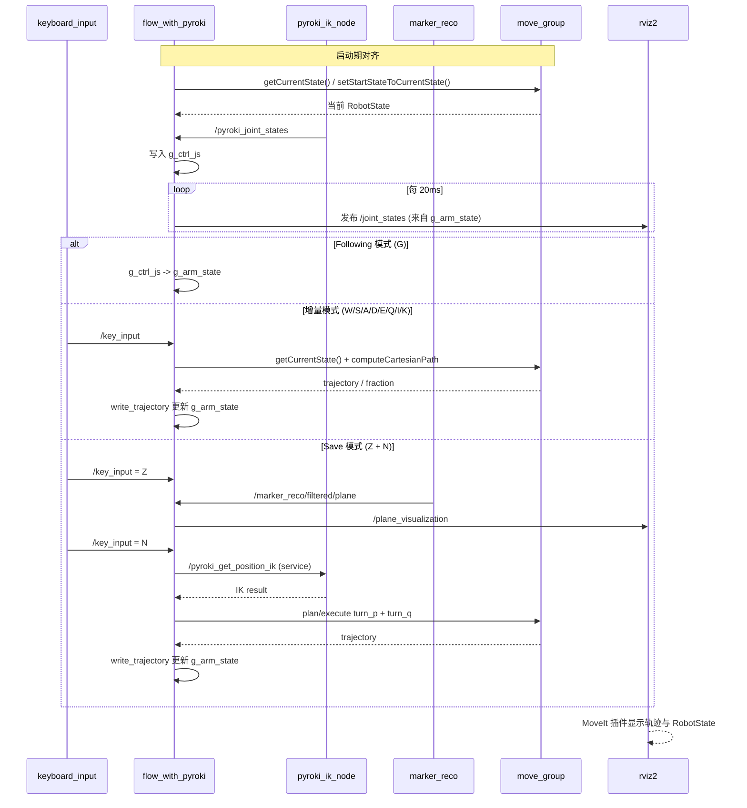

# flow_with_pyroki 系统工作流与数据流说明

本文以 flow_with_pyroki 节点为核心，整理 marker_reco、keyboard_input、pyroki_ik_node、MoveIt、RViz 之间的协作关系与 Topic/Service 数据流。

## 1. 节点角色总览

- flow_with_pyroki
  - 中枢状态机节点，处理按键模式切换、增量规划、Save 子状态机、与 MoveIt 规划交互。
  - 维护并发布当前机械臂状态到 /joint_states。
- pyroki_ik_node
  - 用 Pyroki 做 IK/FK，提供控制参考关节角。
  - 发布 /pyroki_joint_states、/pyroki_controller。
  - 提供 /pyroki_get_position_ik 服务给 flow_with_pyroki 调用。
- keyboard_input
  - 把终端按键转成 /key_input（std_msgs/String）。
- marker_reco_node
  - 识别平面并发布过滤后的几何数据，核心是 /marker_reco/filtered/plane。
- move_group（MoveIt）
  - 负责运动规划、碰撞检测、笛卡尔路径计算。
- rviz2
  - 可视化 RobotState、Marker、MoveIt 规划结果。

## 2. 启动形态（推荐理解）

当前工程常见是分进程启动：

1. 启动 pyroki_ik_node（Python）
2. 启动 flow_with_pyroki.launch.py（包含 move_group + rviz2 + flow_with_pyroki）
3. 启动 keyboard_input（独立终端）
4. 启动 marker_reco_node（视觉）

说明：flow_with_pyroki.launch.py 内部会启动 move_group 和 rviz2，不会自动启动 pyroki_ik_node 与 keyboard_input。

## 3. Topic / Service 全量关系

### 3.1 flow_with_pyroki 相关

- 发布
  - /joint_states (sensor_msgs/msg/JointState)
  - /turn_vectors (visualization_msgs/msg/MarkerArray)
  - /plane_visualization (visualization_msgs/msg/MarkerArray)
- 订阅
  - /pyroki_joint_states (sensor_msgs/msg/JointState)
  - /marker_reco/filtered/plane (robo_arm_msgs/msg/PlaneFrame)
  - /key_input (std_msgs/msg/String)
- 调用服务
  - /pyroki_get_position_ik (moveit_msgs/srv/GetPositionIK)

### 3.2 pyroki_ik_node 相关

- 发布
  - /pyroki_joint_states (sensor_msgs/msg/JointState)
  - /pyroki_controller (moveit_msgs/msg/DisplayRobotState)
- 提供服务
  - /pyroki_get_position_ik (moveit_msgs/srv/GetPositionIK)

### 3.3 keyboard_input 相关

- 发布
  - /key_input (std_msgs/msg/String)

### 3.4 marker_reco_node 相关

- 发布
  - /marker_reco/filtered/plane (robo_arm_msgs/msg/PlaneFrame)
  - /marker_reco/filtered/up_direction (geometry_msgs/msg/Vector3Stamped)
  - /marker_reco/filtered/p_direction (geometry_msgs/msg/Vector3Stamped)
  - /marker_reco/filtered/q_direction (geometry_msgs/msg/Vector3Stamped)
  - /marker_reco/filtered/corners_3d (geometry_msgs/msg/PolygonStamped)
  - /marker_reco/filtered/center_3d (geometry_msgs/msg/PointStamped)
  - /marker_reco/visualization (visualization_msgs/msg/MarkerArray)

## 4. 核心内部状态（flow_with_pyroki）

flow_with_pyroki 内部有两组关键关节状态：

- g_ctrl_js
  - 来自 /pyroki_joint_states，代表“控制器参考状态”。
- g_arm_state
  - 由 flow_with_pyroki 维护并发布到 /joint_states，代表“当前对 MoveIt/RViz 生效的状态”。

此外，flow_with_pyroki 在规划与约束计算时，会通过 MoveGroup 读取“当前机械臂状态”（如 getCurrentState / setStartStateToCurrentState），用于获取当前末端位姿、雅可比与规划起点。

主循环以 20ms 定时器驱动，发布 /joint_states。

## 5. 按模式的数据流

## 5.1 Following 模式（G）

1. pyroki_ik_node 发布 /pyroki_joint_states。
2. flow_with_pyroki 订阅后写入 g_ctrl_js。
3. Following 模式下，update() 周期同步 g_ctrl_js -> g_arm_state。
4. flow_with_pyroki 周期发布 /joint_states。
5. move_group 与 rviz2 观察到新的机器人状态。

用途：让 scene robot 跟随 Pyroki 参考关节角。

## 5.2 增量模式（W/S/A/D/E/Q/I/K）

1. keyboard_input 发布 /key_input。
2. flow_with_pyroki 收到按键后切换到对应 Incremental 控制模式。
3. 调用 plan_incremental_motion：
   - 从当前状态取 EE 位姿
   - 构造 waypoint（起点 + 目标点）
   - 调用 MoveIt computeCartesianPath
4. 规划成功后写轨迹点到 g_arm_state（write_trajectory），并持续发布 /joint_states。
5. 模式切回 IncrementalIdle，等待下一次按键。

## 5.3 Save 模式（Z + N）

Save 是子状态机：

- CalPlane
  - 读取最近一次 /marker_reco/filtered/plane。
  - 计算/更新 g_p_vector、g_q_vector、g_up_vector、g_plane_center。
  - 发布 /plane_visualization。
  - 等待 N 键。
- Hover
  - 计算 hover pose 并可视化。
  - 调用 /pyroki_get_position_ik 检查 hover 目标可解性。
  - 通过后执行沿 q 方向的增量动作。
- Turn_P
  - 规划并执行绕 P 轴半圆。
- Turn_Q
  - 规划并执行绕 Q 轴半圆。

说明：wait_for_enter_key() 明确等待按键 N。

## 6. MoveIt 与 RViz 的关系

- MoveIt（move_group）
  - 接受 flow_with_pyroki 的规划请求（plan / computeCartesianPath）。
  - flow_with_pyroki 会通过 move_group 的当前状态接口读取机械臂当前状态（RobotState），并作为增量规划和约束控制的基准。
  - 做碰撞检测与约束检查。
- RViz
  - 显示 /joint_states 对应的机器人状态。
  - 显示 /turn_vectors、/plane_visualization、/marker_reco/visualization 的 Marker。
  - 显示 MoveIt 规划轨迹与目标姿态（通过 MoveIt 插件和 visual tools）。

## 7. 典型端到端时序（以 flow_with_pyroki 为主）

## 8. 与你当前问题直接相关的点

- Pyroki IK 可解，不等于 MoveIt 可规划。
  - Pyroki 更偏运动学可达。
  - MoveIt 还受 SRDF 碰撞矩阵、起始状态碰撞、路径碰撞影响。
- Save 流程中 marker_reco 角点数量不稳定时，flow_with_pyroki 必须做边界保护。
  - 当前 flow_with_pyroki 已按 >=3 角点接受平面，<4 时跳过角点 marker，仅保留轴向 marker，避免越界崩溃。

## 9. 源码索引

- flow_with_pyroki 主节点与 topic/service：
  - src/plan/src/flow_with_pyroki.cpp
    - 参考：getCurrentState / setStartStateToCurrentState（例如增量规划、UpRestrain、Turn 等路径）。
- keyboard_input：
  - src/plan/src/keyboard_input.cpp
- pyroki_ik_node：
  - src/plan/scripts/pyroki_ik_node.py
- marker_reco_node：
  - src/pose_gen/pose_gen/marker_reco.py
- 启动文件：
  - src/plan/launch/flow_with_pyroki.launch.py
  - src/plan/launch/pyroki_ik.launch.py
