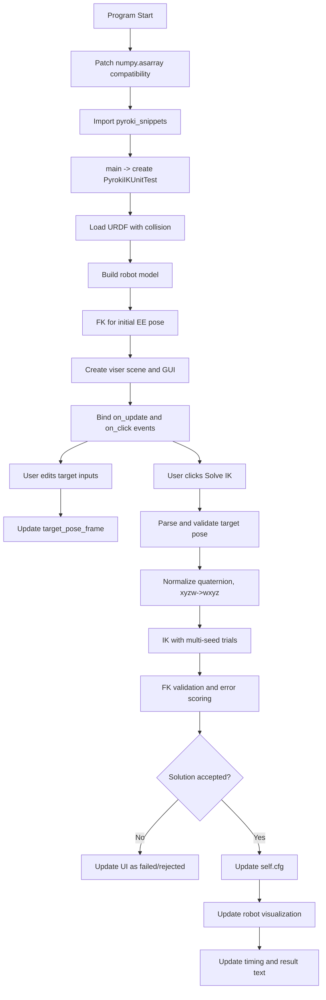

# pyroki_ik_unit_test_node 工作流与数据流

本文档梳理 [src/plan/scripts/pyroki_ik_unit_test_node.py](src/plan/scripts/pyroki_ik_unit_test_node.py) 的执行流程、模块职责和关键数据在各函数之间的流转关系。

## 1. 目标与总体职责

该脚本是一个交互式 IK 测试工具，职责包括：

1. 加载 URDF（包含 collision 相关数据）。
2. 初始化机器人模型与可视化界面。
3. 从 GUI 收集目标位姿输入。
4. 调用 IK 求解并做 FK 误差验证。
5. 将成功解更新到可视化机器人状态。

## 2. 启动阶段工作流

### 2.1 模块导入与兼容补丁

执行顺序（文件顶层）：

1. 导入标准库与第三方库。
2. 调用 `_patch_numpy_asarray_copy_kwarg()`。
3. 调用 `_import_pyroki_snippets()`，得到模块对象 `pks`。
4. 读取环境变量常量：`URDF_PATH`、`EE_LINK`。

`_patch_numpy_asarray_copy_kwarg()` 的作用：

1. 检测当前 NumPy 是否支持 `np.asarray(..., copy=...)`。
2. 若不支持，则替换当前进程内的 `np.asarray`，保证兼容调用链（例如 JAX/pyroki 侧可能触发该参数）。

`_import_pyroki_snippets()` 的导入策略：

1. 先尝试常规 import。
2. 失败后读取 `PYROKI_EXAMPLES_PATH` 并插入 `sys.path`。
3. 仍失败则抛出可读错误，提示配置环境。

### 2.2 主程序入口

`main()` 流程：

1. 配置日志格式与等级。
2. 实例化 `PyrokiIKUnitTest()`。
3. 进入 `while True` 保持进程存活，等待 GUI 事件。

## 3. 类初始化工作流（PyrokiIKUnitTest.__init__）

### 3.1 模型加载

1. 调用 `yourdfpy.URDF.load(...)`：
2. `filename_handler` 使用 `_make_package_filename_handler()` 解析 `package://` 路径。
3. `build_collision_scene_graph=True`。
4. `load_meshes=True`。
5. `load_collision_meshes=True`。
6. 通过 `pk.Robot.from_urdf(...)` 构建 pyroki 机器人对象。

### 3.2 初始状态与可视化

1. 设置初始关节配置 `self.cfg`。
2. 调用 `_fk_ee(self.cfg)` 计算末端初始位姿。
3. 创建 viser server、地面网格、URDF 可视化对象。
4. 调用 `self.viser_urdf.update_cfg(self.cfg)` 同步初始姿态。

### 3.3 GUI 控件与事件绑定

1. 创建目标位姿输入框：`target_x/y/z` 与 `target_qx/qy/qz/qw`。
2. 创建按钮与状态控件：`solve_btn`、`result_text`、`timing`。
3. 在场景中创建目标坐标系 `target_pose_frame`。
4. 绑定输入框 `on_update`：任何输入变化触发 `_update_target_pose_visualization()`。
5. 绑定按钮 `on_click`：触发 `_solve_from_input_pose_and_update_ui()`。

## 4. 运行时工作流（一次 Solve 按钮点击）

### 4.1 高层顺序

1. `_solve_from_input_pose_and_update_ui()` 读取并校验输入。
2. 更新目标 frame 显示。
3. 将输入四元数 `xyzw` 归一化并转换为 `wxyz`。
4. 调用 `_ik_with_validation(target_position, target_wxyz)`。
5. 若有解且通过阈值，更新 `self.cfg` 与 URDF 显示。
6. 更新 UI 文本与耗时统计。

### 4.2 IK 与验证（_ik_with_validation）

1. 以当前 `self.cfg` 为基准种子，构造多组候选 seed。
2. 对每个 seed 调 `pks.solve_ik(...)`。
3. 每个候选解都执行 `_fk_ee(cfg_solution)` 获取实际末端位姿。
4. 计算位置误差与姿态误差：
5. `pos_err = ||ee_xyz - target_position||`。
6. `ori_err = _quat_angle_error_rad(target_wxyz, ee_wxyz)`。
7. 使用 `score = pos_err + 0.05 * ori_err` 选择最优候选。
8. 若满足严格阈值（3mm + 3deg）则提前返回。
9. 否则返回最佳候选（或全失败时返回 `None`）。

### 4.3 结果判定（_solve_from_input_pose_and_update_ui）

1. 若 `_ik_with_validation` 全失败：UI 显示失败。
2. 若有解但超过宽松阈值（0.3m + 90deg）：判定 rejected。
3. 若通过：
4. 更新 `self.cfg`。
5. 调 `self.viser_urdf.update_cfg(self.cfg)` 刷新机器人显示。
6. 更新 `result_text` 与平滑后的 `timing`。

## 5. 关键函数的数据输入输出

### 5.1 _get_target_pose

输入来源：GUI 文本框字符串。
输出：

1. `target_position: np.ndarray shape=(3,)`。
2. `target_xyzw: np.ndarray shape=(4,)`。
3. 输入非法时返回 `(None, None)`。

### 5.2 _update_target_pose_visualization

输入：`_get_target_pose()` 的结果。
处理：

1. 有限值检查。
2. 四元数归一化。
3. `xyzw -> wxyz` 变换。
4. 写入 `self.target_pose_frame.position/wxyz`。

输出：目标 frame 可视化状态更新。

### 5.3 _fk_ee

输入：

1. `cfg`（关节配置向量）。
2. `EE_LINK`（末端链接名）。

处理：

1. 调 `self.robot.forward_kinematics(cfg)`。
2. 在 link 列表中定位 `EE_LINK` 的索引。
3. 从对应行取 `wxyz` 与 `xyz`。

输出：`(xyz, wxyz)`。

### 5.4 _quat_angle_error_rad

输入：目标与实际四元数（wxyz）。
输出：弧度误差，范围约为 `[0, pi]`。

## 6. 数据流总览

### 6.1 主要状态变量

1. `self.cfg`：当前机器人关节状态（核心状态）。
2. `self.urdf`：URDF 模型对象。
3. `self.robot`：pyroki 机器人对象。
4. `target_*`：GUI 输入值（字符串）。
5. `target_pose_frame`：场景中的目标位姿可视化对象。

### 6.2 数据变换链

1. GUI 字符串 -> 浮点数组（_get_target_pose）。
2. `xyzw` -> 归一化 `xyzw` -> `wxyz`（_solve_from_input_pose_and_update_ui）。
3. 目标 pose + seed -> IK 解 `cfg_solution`（_ik_with_validation）。
4. `cfg_solution` -> FK `ee_xyz, ee_wxyz`（_fk_ee）。
5. 误差计算 -> 接受/拒绝。
6. 接受后 `self.cfg` 更新 -> `viser_urdf.update_cfg`。

## 7. Mermaid 流程图

## 8. 常见失败点（排障建议）

1. `pyroki_snippets` 导入失败。
   - 检查 `PYTHONPATH` 或 `PYROKI_EXAMPLES_PATH`。
2. URDF 资源解析失败（`package://`）。
   - 检查 `_make_package_filename_handler` 的 search_roots 是否覆盖你的包路径。
3. IK 有返回但被拒绝。
   - 说明姿态/位置误差超阈值，先检查目标姿态是否可达。
4. EE_LINK 不匹配。
   - `_fk_ee` 会报 link 不存在，需核对 `ROBO_ARM_EE_LINK`。

## 9. 可选优化方向

1. 去掉未使用的 `JOINT_NAMES` 常量。
2. 将阈值参数化为环境变量或配置文件。
3. 增加 collision 检测结果显示（当前仅加载 collision 数据，未做碰撞判定）。
