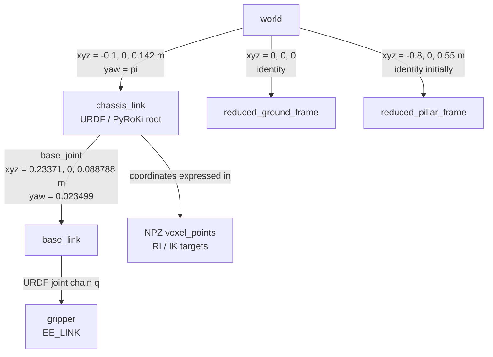

# PyRoKi Reachability Index

`vis_ik_ri.py` is the single entry point for calculating, saving, and viewing the PyRoKi reachability index (RI).

The RI voxel coordinates and IK target poses use the URDF root frame `chassis_link`. Newly written NPZ files contain `frame_id=chassis_link`.

## TF and Coordinate Frames

The default combined URDF has `chassis_link` as its root. `world` is external to the URDF and PyRoKi; ROS and Viser add it around the same robot model.



### URDF and PyRoKi FK

PyRoKi loads the selected URDF directly. Given joint configuration $q$, FK returns every link pose in the URDF root frame $C=\texttt{chassis_link}$:

$$
{}^{C}T_{\mathrm{link}}(q)
$$

For the end effector $E$ selected by `ROBO_ARM_EE_LINK` (default `gripper`):

$$
{}^{C}T_E(q) =
\begin{bmatrix}
{}^{C}R_E(q) & {}^{C}\mathbf p_E(q) \\
0 & 1
\end{bmatrix}
$$

`base_link` is not the FK root. Its fixed transform in the default URDF is:

$$
{}^{C}T_B = \operatorname{Trans}(0.23371, 0, 0.088788)\,R_z(0.023499)
$$

A point expressed in `base_link` would require the complete $ {}^{C}T_B $ transformation before use as a PyRoKi target. The current RI workflow intentionally bypasses `base_link` and samples directly in `chassis_link`.

### RI Grid, IK, and NPZ

`--bounds` is sampled in `chassis_link`, and each voxel center is supplied unchanged to the PyRoKi pose cost:

$$
{}^{C}\mathbf p_{\mathrm{voxel}}
= {}^{C}\mathbf p_{\mathrm{IK\ target}}
$$

The script combines that translation with sampled target orientations, solves IK, then validates the result against FK in the same frame:

$$
{}^{C}T_E(q) \approx {}^{C}T_{\mathrm{target}}
$$

The NPZ `voxel_points` array stores those identical $ {}^{C}\mathbf p_{\mathrm{voxel}} $ coordinates. `ri_values` and `pose_success_counts` are scalars indexed by each point and have no frame themselves. New files write `frame_id="chassis_link"`.

Legacy NPZ files without `frame_id` can be opened, but their source frame cannot be verified. A file with an explicit frame different from the active `ROBO_ARM_RI_FRAME` is rejected.

### Capability-Map Fields and SFE

Newly calculated NPZ files also contain directional capability data derived from the sampled TCP orientations:

| NPZ field | Meaning |
|---|---|
| `direction_vectors` | Sampled TCP local $+Z$ axes in `chassis_link`. |
| `direction_success_mask` | Boolean `(voxel, direction)` mask: an IK solution passed position and orientation validation. |
| `shape_type` | Best fitted `cone`, `double_cone`, or `ring_cylinder` primitive. |
| `shape_axis` | Best primitive axis $\mathbf a$. |
| `shape_opening_angle_rad` | Fitted opening angle $\alpha$. |
| `shape_sfe` | Shape Fit Error from 0 (exact) to 100 (poor). |

For a primitive, let $R$ be the number of reachable sampled directions, $r$ the reachable directions missed by the primitive, and $u$ the unreachable directions incorrectly included. The implementation follows the paper's capped relative error:

$$
\mathrm{SFE}=100\min\left(1,\frac{u+r}{R}\right)
$$

The implementation tests the three axisymmetric shapes from the paper: a single cone, a double cone, and a ring-cylinder. It saves the one with the lowest SFE for each voxel.

### ROS `flow_with_pyroki` TFs

The ROS static transform publisher uses `x y z yaw pitch roll`, so its launch arguments define:

$$
{}^{W}T_C = \operatorname{Trans}(-0.1, 0, 0.142)\,R_z(\pi),
\qquad W=\texttt{world}
$$

`flow_with_pyroki` initializes its environment frames as:

$$
{}^{W}T_G = I,
\qquad
{}^{W}T_P = \operatorname{Trans}(-0.8, 0, 0.55)
$$

where $G=\texttt{reduced_ground_frame}$ and $P=\texttt{reduced_pillar_frame}$. The runtime Save demo may randomize the pillar; this standalone viewer shows the initial pose and does not subscribe to ROS TF.

### Viser NPZ Display

Viser reproduces the initial ROS tree with these scene paths:

| Viser node | Frame / contents |
|---|---|
| `/world` | Viser scene world frame. |
| `/world/chassis_link` | Applies $ {}^{W}T_C $. |
| `/world/chassis_link/robot` | `ViserUrdf` robot; URDF FK is relative to `chassis_link`. |
| `/world/chassis_link/ri/reachable` | Reachable NPZ `voxel_points`. |
| `/world/chassis_link/ri/unreachable` | Unreachable NPZ `voxel_points`. |
| `/world/reduced_ground_frame/mesh` | `ground_link.STL` at $ {}^{W}T_G $. |
| `/world/reduced_pillar_frame/mesh` | `pillar_link.STL` at initial $ {}^{W}T_P $. |

Thus both RI and robot share the same outer world transform:

$$
{}^{W}\mathbf p_{\mathrm{voxel}}
= {}^{W}T_C\,{}^{C}\mathbf p_{\mathrm{voxel}}
$$

$$
{}^{W}T_E(q) = {}^{W}T_C\,{}^{C}T_E(q)
$$

## Requirements

Run commands from the workspace root after sourcing the ROS and workspace overlays:

```bash
cd /home/hku/robo_arm
source /opt/ros/jazzy/setup.bash
source install/setup.bash
```

The Python environment must provide `pyroki`, `jax`, `jaxls`, `jaxlie`, `yourdfpy`, `viser`, and `trimesh`.

## Calculate and View

The following calculates the default workspace, saves it to `output/pk_ik_ri.npz`, then opens a Viser server on port `8082`:

```bash
python3 src/plan/scripts/vis_ik_ri.py
```

The scene includes the robot, RI voxels, `reduced_ground`, and `reduced_pillar`. Their poses match the initial TF setup in `flow_with_pyroki`:

- `world -> chassis_link`: translation `(-0.1, 0, 0.142)` m and yaw `pi`.
- `world -> reduced_ground_frame`: translation `(0, 0, 0)` m.
- `world -> reduced_pillar_frame`: translation `(-0.8, 0, 0.55)` m.

## Calculate Without Viewer

Use `--no-view` for batch runs:

```bash
python3 src/plan/scripts/vis_ik_ri.py \
  --bounds -1.0 1.0 -1.0 1.0 -0.5 1.0 \
  --resolution 0.05 \
  --ori-samples 64 \
  --output output/pk_ik_ri.npz \
  --no-view
```

Important calculation options:

- `--bounds XMIN XMAX YMIN YMAX ZMIN ZMAX`: scan box in `chassis_link`, metres.
- `--resolution`: voxel edge length in metres.
- `--ori-samples`: orientations sampled per voxel.
- `--ik-pos-tol`: accepted FK position error in metres.
- `--ik-ori-tol-deg`: accepted FK orientation error in degrees.
- `--batch-size`, `--seed-count`, `--refine-count`: JAX/PyRoKi solve workload and multistart settings.
- `--output`: destination NPZ path.

## View an Existing Result

```bash
python3 src/plan/scripts/vis_ik_ri.py \
  --input-npz output/pk_ik_ri.npz
```

`--input` is an equivalent alias for `--input-npz`. Use `--port` to choose another Viser port.

The viewer provides reachable/unreachable visibility controls, opacity controls, and an optional Z slice. It rejects a file with an explicit `frame_id` other than `chassis_link`; legacy files without a frame id can still be opened, but their coordinate convention cannot be verified.

For a newly calculated capability-map NPZ, the viewer additionally provides:

- Red-to-blue RI coloring: red is low RI, blue is high RI, matching the paper.
- An arbitrary-plane slab cut: set plane normal, offset, and thickness to inspect the workspace interior from any orientation.
- Direction filtering: enter an approach-direction vector and angular tolerance to retain only voxels with a matching reachable sampled direction.
- Voxel inspection: click a visible voxel. Green points are the reachable sampled directions, red points are unreachable directions, and blue diamond points are the fitted primitive's predicted directions. The panel reports RI, primitive type, axis, opening angle, and SFE.

Rotation and zoom are supplied by the standard Viser camera controls. Older NPZ files remain RI-viewable, but direction filtering and voxel capability inspection require the new directional fields and therefore require recalculation.

## Robot and Environment Overrides

Set these before starting the script when using another compatible model:

```bash
export ROBO_ARM_URDF=path/to/robot.urdf
export ROBO_ARM_EE_LINK=gripper
export ROBO_ARM_RI_FRAME=your_urdf_root_link
```

`ROBO_ARM_RI_FRAME` must exactly match the selected URDF's PyRoKi root link; it labels the direct IK-target coordinates and does not apply a transform to another link.
